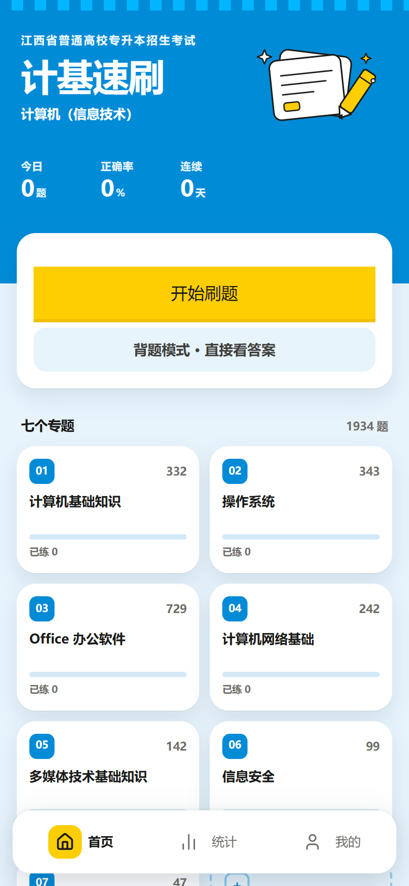
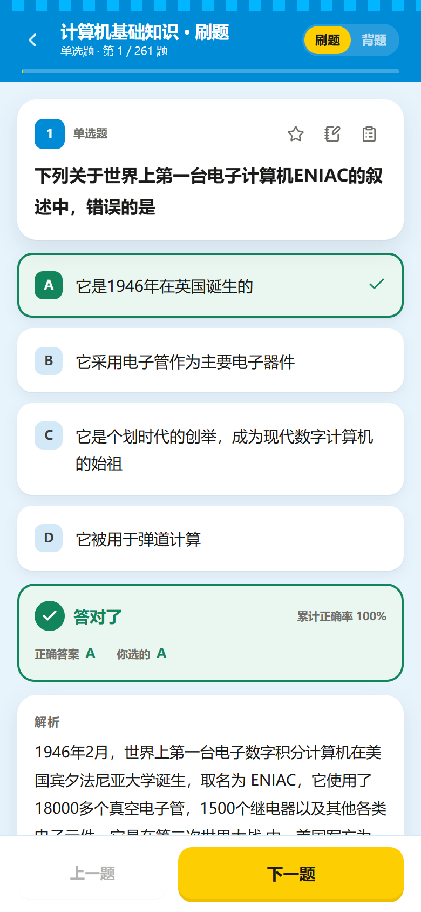
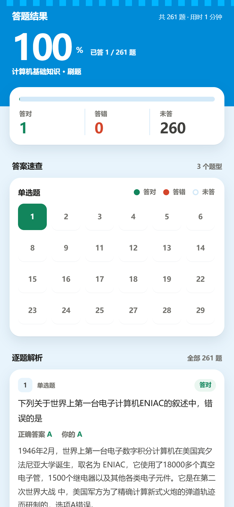

<p align="center">
  
</p>

<p align="center">
  <a href="https://cheshiping.github.io/IT-practicing/"><b>打开网站 →</b></a>
  &nbsp;·&nbsp; 手机与电脑都能用
  &nbsp;·&nbsp; 不登录
  &nbsp;·&nbsp; 进度只存在自己的浏览器里
</p>

**在线地址：<https://cheshiping.github.io/IT-practicing/>**

---

## 这是什么

面向江西统考专升本「计算机（信息技术）」科目的刷题网站。题目、答案与解析全部来自纸质教辅《江西省专升本必刷2000题·信息技术》及其配套答案册的扫描件抽取，**不编造、不用示例占位数据**，每道题都能溯源到原书页码。

它是为「课间十分钟、睡前二十分钟」这种碎片时间做的：打开就刷，刷完立刻判分，答错的自动进错题本。

## 界面

<p align="center">
  
  
  
</p>

<p align="center"><sub>首页 · 答题 · 结果</sub></p>

## 能做什么

| 模块 | 说明 |
|---|---|
| 选题 | 按专题（7 个）→ 题型（8 类）选；「Office 办公软件」再分 Word / Excel / PowerPoint 三个板块；刷题与背题两种模式 |
| 判分 | 单选、多选、判断自动判定；填空按关键词比对（容忍空格、全半角、标点与「A（或B）」备选说法）；答错立刻给正确答案、你的答案与累计正确率 |
| 主观题 | 简答 / 分析 / 操作 / 综合应用题：先自己作答，再揭示参考答案，由你自评「答对了 / 没答对」，同样计入正确率与错题本 |
| 申诉 | 填空题参考答案来自扫描件，若 OCR 有误差可点「我写的是参考答案」改正本次判定 |
| 答题卡 | 密排题号表，答对填绿、答错填红、当前题描黄，点任意题号跳转 |
| 错题本 | 答错自动入库，记录错误次数与最近时间，可搜索、只看未消灭、一键重练 |
| 收藏 / 笔记 | 题目级收藏与随手笔记，随进度持久化 |
| 统计 | 完成度、掌握度、正确率、近 14 天题量、练得最多的小节 |
| 我的 | 昵称、考试日期、每日目标、字号缩放、减少动效、数据导入导出 |

## 数据从哪来

原始数据是两份扫描版 PDF（题目 170 页 / 答案 98 页）。文本流顺序与视觉顺序不一致，选项按 4 列网格排布，普通文本抽取拿不到结构，所以 `scripts/extract.py` 按坐标重建版面：

1. 取每页 span 级坐标 → 按 y 聚成视觉行 → 行内按 x 排序 → 按间隙切成列段
2. 用本页识别成功的选项字母学习「选项网格列 x」，据此判断哪些列段是选项
3. 选项字母被 OCR 认错时（B→人、D→旦）按位置恢复；题号被拆成多段（「18 8.」）时先合并再匹配
4. 以「题号归 1」切分教材小节，再与答案册按（小节, 题号）对齐
5. 解析正文取「首行 + 续行」，并过滤页眉水印与插图乱码
6. 第三章（Office）没有软件分节标题，按题干内容给每题判 Word / Excel / PowerPoint，再做段落平滑，跨段个案逐条对着原书复核

| 指标 | 数值 |
|---|---|
| 解析出的题块 | 2151 |
| 发布到线上 | **1942**，全部可练 |
| 其中自动判分 | 1496（单选 1077 / 多选 197 / 判断 222） |
| 其中填空自测 | 320（输入关键词比对；原书答案即为短词，比对可靠） |
| 其中参考答案自评 | 126（简答 47 / 综合应用 57 / 分析 17 / 操作 5） |
| 因题干残缺 / 选项异常 / 答案无法判读而排除 | 209（清单见 `build/data-report.json`） |

被排除的题**不会**上线，也不会用编造内容补齐。原书 OCR 本身有零星误差，站内每题标注原书页码，备考请以原书为准。

## 本地跑起来

```bash
npm install
npm run dev                # 开发服务器 http://localhost:5173
npm run build              # 客户端 → SSR bundle → 构建期预渲染
node scripts/serve.mjs     # 与 GitHub Pages 同规则的静态服务器，端口 4180
```

> `vite preview` 对未知路径会回落到 `index.html`，与 GitHub Pages 行为不同。
> 验证深链（如 `/quiz/xxx`）请用 `scripts/serve.mjs`，它会像 Pages 一样返回 `404.html`。

重新生成题库：

```bash
pip install pymupdf
python scripts/extract.py
```

端到端验证（真实驱动 Chromium 跑完整流程并收集控制台错误）：

```bash
npm run build
node scripts/serve.mjs &
BASE_URL=http://localhost:4180 node scripts/verify.mjs
```

## 部署

仓库内置 `.github/workflows/deploy.yml`，`push` 到 `main` 即自动构建并发布到 GitHub Pages。

- 构建先产出客户端 bundle，再产出 SSR bundle，最后由 `scripts/prerender.mjs` 把 7 个公开路由渲染成静态 HTML
- `404.html` 使用**空壳模板**：否则客户端在 `/quiz/*` 这类动态路由上会拿首页 HTML 水合，触发 React 水合不一致
- 项目站点自动推导 `base`（`/<repo>/`），路由与数据请求都走 `import.meta.env.BASE_URL`

```bash
npm run build                                 # 本地验证
BASE_PATH=/IT-practicing/ npm run build       # 模拟子路径部署
```

线上地址：**<https://cheshiping.github.io/IT-practicing/>**

## 技术栈

Vite 8 · React 19 · TypeScript · Tailwind CSS v4 · shadcn/ui（Radix 版，`components/ui` 由 CLI 生成，业务代码只做组合）· React Router 7（`basename` 适配子路径）· Zustand（`persist` + `skipHydration` 避免水合不一致）。

视觉系统与令牌在 [`DESIGN.md`](./DESIGN.md) 第 12 章：配色取自插画工作室画册——天蓝铺底、奶油黄做动作色、白卡浮在色块上、黑线条手绘插画。五次改版的取舍记录也在那里。

## 已知限制

- **历年真题**：题源是教材同步训练，不含真题。选题浮层保留了年份入口并明确说明未接入
- **排名**：没有后端，统计页只展示本机记录，不做任何无数据来源的排行榜
- **题目插图**：扫描件里的插图未纳入线上版本，涉及配图的题可能影响理解
- **OCR 误差**：个别字符识别有误，建议对照原书核对

## 目录结构

<details>
<summary>展开</summary>

```
├─ src/
│  ├─ components/ui/       shadcn/ui 组件（CLI 生成，不写业务逻辑）
│  ├─ components/common/   选项卡、答题卡、手绘插画、空态
│  ├─ components/layout/   应用外壳：天蓝状态条、底部胶囊导航、桌面横条
│  ├─ features/            home / library / quiz / wrongbook / favorites / stats / profile
│  ├─ data/                类型、加载与判分
│  ├─ store/               Zustand 状态与本地持久化
│  └─ entry-server.tsx     构建期预渲染入口
├─ scripts/                extract.py / prerender.mjs / serve.mjs / verify.mjs
├─ public/data/            题库 JSON
├─ assets/readme/          README 视觉素材
└─ DESIGN.md               设计文档
```

</details>
